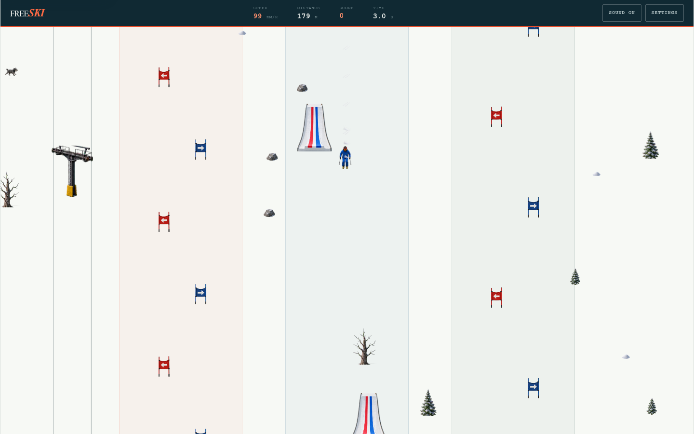

# FreeSki

A modern browser tribute to the retro Windows classic **SkiFree**, with slalom courses, freestyle tricks, lively slopes, and a relentless Yeti. Built with TypeScript and Phaser, with original artwork and sound.



Ski freely or cross a start gate to enter **Slalom**, **Tree Slalom**, or **Free Style**. Dodge obstacles, land tricks, and see how far you can get before the Yeti catches up.

## Run locally

Requires **Node.js 22.12+**.

```bash
npm ci
npm run dev
```

Open the local URL printed in the terminal.

## Controls

| Action                       | Keyboard                 |
| ---------------------------- | ------------------------ |
| Steer                        | Left/right arrows or A/D |
| Tuck                         | Down arrow or S          |
| Brake                        | Shift or B               |
| Jump / rotate                | Space, Up arrow, or W    |
| Spin left / right (airborne) | Q / E                    |
| Spread / daffy (airborne)    | Z / X                    |
| Boost                        | F                        |
| Pause                        | Escape or F3             |
| Restart                      | R or F2                  |
| Mute / unmute                | M                        |

Mouse steering, click-to-jump, touch controls, and standard gamepads are also supported. Open **Settings** to change pointer controls, sound, and accessibility options. Preferences and records stay in your browser.

## Build and test

```bash
npm test
npm run build
npm run preview
```

The production build is written to `dist/`.
